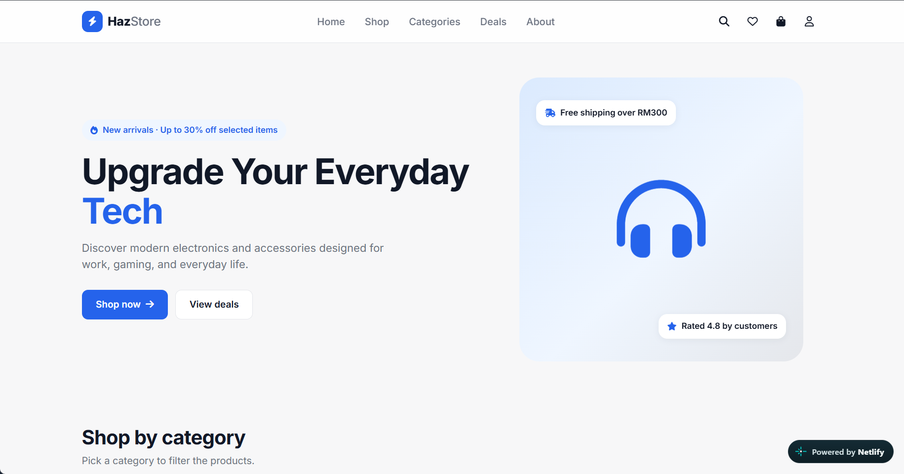

# Haz Store – E-commerce Frontend

Haz Store is a modern, responsive e-commerce website for a fictional electronics shop. It is built with plain HTML, CSS and JavaScript (no frameworks, no libraries), so it runs with just a browser or the VS Code Live Server extension.

I built this project to practise DOM manipulation, array methods, local storage, accessibility and responsive design.

**[🔗 Live Demo](https://hazstore-ecommerce.netlify.app/)** · [Source code](https://github.com/hazell-lab/Haz-Store) · [Portfolio](https://hazimaqil-portfolio.netlify.app)



## Technologies

- HTML5
- CSS3 (custom properties, grid, flexbox, media queries)
- Vanilla JavaScript (ES6)
- Google Fonts (Inter)
- Font Awesome icons

## Features

- Responsive navbar with a hamburger menu on mobile
- Hero section with a promo badge
- Category cards that filter products (the active category is highlighted)
- 20 fictional products stored in JavaScript
- Live search by product name or category
- Filters: category, price range, rating, availability
- Sorting: featured, price, rating, name
- Product details modal with a quantity selector
- Shopping cart drawer (add, remove, increase, decrease, clear)
- Shipping calculation with free shipping at RM300 and above
- Wishlist with a heart toggle
- Recently viewed products
- Deals section with discount badges and calculated sale prices
- Featured products section
- Frontend-only checkout with form validation (Malaysian phone numbers and 5-digit postcodes)
- Toast notifications
- Empty states for the cart, wishlist, search and recently viewed
- Cart, wishlist and recently viewed saved with local storage (saved data is checked against current stock when the page loads)

## Accessibility

- Every part of the site can be used with the keyboard only
- Focus stays on the same button after the cart or wishlist updates
- Drawers and the modal keep the Tab key inside them, close with Escape, and send focus back to the button that opened them
- Labels on all form fields, `aria-invalid` on fields with errors, and live regions for results and toasts
- Animations are turned off for users who enable "reduce motion" on their device

## JavaScript concepts demonstrated

- Variables (`const` and `let`)
- Functions
- Arrays and objects
- Array methods: `map`, `filter`, `find`, `some`, `reduce`, `sort`, `includes`, `slice`
- DOM manipulation (`getElementById`, `querySelector`, `innerHTML`, `classList`, `createElement`)
- Event listeners and event delegation (`closest`, `dataset`)
- Template literals
- Conditionals and `switch`
- Local storage with `JSON.stringify` and `JSON.parse`, wrapped in `try/catch`
- Form validation with regular expressions

## Folder structure

```
Haz-Store/
├── index.html
├── css/
│   └── style.css
├── js/
│   ├── products.js
│   └── script.js
├── assets/
│   ├── images/
│   └── icons/
├── docs/
│   └── screenshot.png
└── README.md
```

## How to run

1. Clone this repository (or download it as a ZIP):
   ```bash
   git clone https://github.com/hazell-lab/Haz-Store.git
   ```
2. Open the `Haz-Store` folder in VS Code
3. Install the "Live Server" extension
4. Right-click `index.html` and choose "Open with Live Server"

You can also open `index.html` directly in a browser. An internet connection is needed for Google Fonts and the Font Awesome icons.

## How to replace product images

1. Put your images inside `assets/images/`
2. Name them `product-1.jpg`, `product-2.jpg` and so on (the number matches the product `id`)
3. Or change the `image` path of any product in `js/products.js`

If an image file is missing, a grey placeholder is shown instead, so the page never looks broken.

## How to add products

Open `js/products.js` and add a new object at the end of the `products` array. Remember the comma after the previous product.

```js
{
    id: 21,
    name: "Nova Speaker Mini",
    category: "Accessories",
    price: 119.00,
    discount: 0,
    rating: 4.3,
    stock: 20,
    image: "assets/images/product-21.jpg",
    description: "Small Bluetooth speaker with deep bass.",
    featured: false
}
```

- `id` must be unique
- `category` must match one of the names in the `categories` array exactly, including capital letters
- `discount` is a percentage (0 means no discount)
- The old price and the sale price are calculated automatically
- Set `featured: true` to show the product in the featured section

## Future improvements

- Real backend and database
- User login and registration
- Real payment gateway
- Product reviews
- Order history page
- Admin dashboard
- Fetch products from an API
- Rebuild the project with React

## Author

Built by **Hazim Aqil**, Software Engineering student at the German-Malaysian Institute (GMI).

- Portfolio: [hazimaqil-portfolio.netlify.app](https://hazimaqil-portfolio.netlify.app)
- GitHub: [@hazell-lab](https://github.com/hazell-lab)
- LinkedIn: [mdhazimaqil](https://www.linkedin.com/in/mdhazimaqil/)
