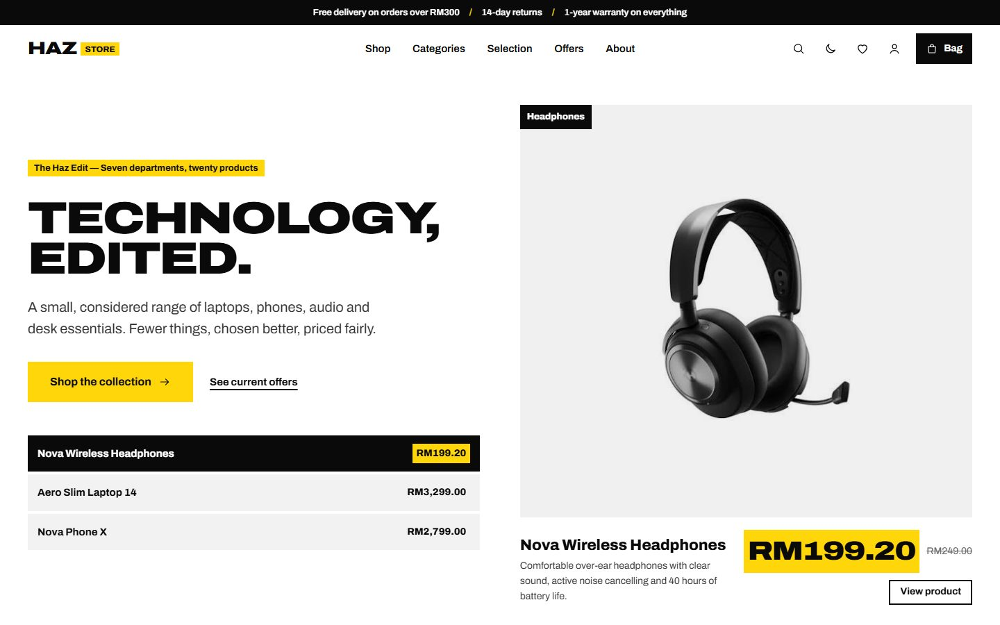

# Haz Store – E-commerce Frontend

Haz Store is a responsive e-commerce frontend for a fictional electronics shop, with a bold, product-first look: black and white, one signal yellow, and a heavy grotesk typeface. Version 2 rebuilds the original vanilla JavaScript site as a **React + Vite** single page app with real routes, reusable components, custom hooks and an automated test suite.

It is a portfolio project. Products, prices and stock are sample data, and the checkout is a clearly labelled demo: no order is sent anywhere, no payment is taken and nothing is shipped.

**[🔗 Live Demo](https://hazstore-ecommerce.netlify.app/)** · [Source code](https://github.com/hazell-lab/Haz-Store) · [Portfolio](https://hazimaqil-portfolio.netlify.app)



## Features

**Shopping**
- Home page with a product spotlight, departments, editor's selection, offers, top rated (by real rating data) and recently viewed
- Shop page with search, category, price, rating and availability filters that all combine, five sort options, a result count, removable filter chips, "clear all", an empty state and "show more" paging
- Filters live in the URL (`/shop?category=Mice&price=under100`), so results can be shared, bookmarked and restored with the back button
- Header search with live product suggestions (keyboard friendly combobox)
- Product pages (`/product/:id`) with image zoom, price and discount, stock, quantity selector, add to bag, wishlist, a details list built only from real product fields, related products and recently viewed

**Bag, wishlist and checkout**
- Slide-in bag drawer and a full bag page, with quantity limits based on stock and a free shipping progress bar (free from RM300, otherwise RM10)
- Wishlist page with a heart toggle on every product card
- Recently viewed products (newest first, no duplicates, last six)
- Demo checkout with field validation (Malaysian phone numbers, 5-digit postcodes), a loading state and a confirmation; no card or bank details are ever asked for
- Bag, wishlist, recently viewed and theme are saved in local storage, checked against the catalog on load and kept in sync between tabs

**Quality**
- Loading skeletons, an error state with "try again", empty states and a 404 page
- Light and dark theme (follows the system setting, choice is saved)
- Keyboard accessible throughout: focus moves to the page heading after navigation, drawers trap focus and close with Escape, labels and live regions everywhere
- Animations are turned off for users who enable "reduce motion"
- Pages other than home are code split and load on first visit

## Technologies

- React 19 and React Router 7
- Vite 8
- Vitest, React Testing Library, user-event and jest-dom (jsdom)
- CSS with custom properties, grid and flexbox (no CSS framework)
- Google Fonts (Archivo) and inline SVG icons

## Getting started

You need [Node.js](https://nodejs.org/) 22.12 or newer (Vitest needs it; Vite alone runs on 20.19+).

```bash
git clone https://github.com/hazell-lab/Haz-Store.git
```

```bash
cd Haz-Store
```

```bash
npm install
```

| Command | What it does |
| --- | --- |
| `npm run dev` | Start the dev server at http://localhost:5173 |
| `npm run build` | Build the production site into `dist/` |
| `npm run preview` | Serve the production build at http://localhost:4173 |
| `npm test` | Run the test suite once |
| `npm run test:watch` | Run the tests in watch mode |

On Windows PowerShell 5.1, run commands one at a time (`&&` is not supported there).

## Environment variables

None. The app has no backend, API keys or secrets. Products are loaded from the static file `public/data/products.json`.

## Project structure

```
Haz-Store/
├── index.html                 # vite entry (theme script, fonts, root element)
├── public/
│   ├── _redirects             # netlify: send every route to the app
│   ├── assets/images/         # product photos
│   └── data/products.json     # the product catalog
├── src/
│   ├── main.jsx               # renders the app
│   ├── App.jsx                # providers and routes
│   ├── config.js              # store rules (shipping, limits, storage keys)
│   ├── components/            # header, footer, cards, drawer, filters, forms...
│   ├── context/               # catalog, store (bag/wishlist/recent), toasts, ui
│   ├── hooks/                 # useCart, useWishlist, useRecentlyViewed,
│   │                          # useProductFilters, useLocalStorage, useDialog...
│   ├── pages/                 # home, shop, product, bag, wishlist, checkout, 404
│   ├── services/              # loads and checks the catalog json
│   ├── styles/                # design tokens and styles, split by area
│   ├── utils/                 # pricing, filters, cart maths, validation
│   └── test/                  # test setup and helpers
├── docs/                      # design notes and screenshots
├── netlify.toml
└── vite.config.js
```

Business rules (prices, filters, cart totals, validation) are plain functions in `src/utils`, so they are easy to test and reuse. Components stay small and get their data from hooks.

## Tests

`npm test` runs 72 tests in 12 files:

- unit tests for pricing, price formatting, search, every filter and sort, URL filter parsing, cart maths, saved data cleaning, recently viewed order, form validation and the catalog loader
- DOM tests that render the whole app and use it like a person would: filtering and clearing, search suggestions, adding to the bag, quantity and stock limits, wishlist, product pages, the demo checkout (errors, loading, confirmation), loading and error states, the mobile menu and the 404 page

## Deployment (Netlify)

`netlify.toml` already holds the settings: build command `npm run build`, publish folder `dist`, and a redirect that sends every route to `index.html` so links like `/product/3` work on refresh. Connect the repository in Netlify and it builds on every push.

## Adding products

Add an object to the `products` array in `public/data/products.json` and put the photo in `public/assets/images/`:

```json
{
  "id": 21,
  "name": "Nova Speaker Mini",
  "category": "Accessories",
  "price": 119,
  "discount": 0,
  "rating": 4.3,
  "stock": 20,
  "image": "/assets/images/product-21.jpg",
  "description": "Small Bluetooth speaker with deep bass.",
  "featured": false
}
```

- `id` must be unique and `category` must match a name in `categories`
- `discount` is a percentage; the sale price is calculated
- `featured: true` puts the product in the editor's selection and the hero spotlight
- Entries with missing fields are skipped instead of breaking the page; a missing image shows a placeholder

## Design and history

- [`docs/v2/UPGRADE.md`](docs/v2/UPGRADE.md): the React upgrade, technical decisions, test results and known limits, with before and after screenshots
- [`docs/reskin/RESKIN.md`](docs/reskin/RESKIN.md): the current visual identity (palette, type, shapes)
- [`docs/redesign/REDESIGN.md`](docs/redesign/REDESIGN.md): earlier redesign notes (its serif identity has since been replaced)

The original vanilla HTML, CSS and JavaScript version is kept in the git history.

## Future improvements

- Real backend, accounts and order history
- A real payment provider (in its test mode first)
- Product reviews and more photos per product
- Product data such as specs and release dates, so "new arrivals" and spec tables can be shown honestly

## Author

Built by **Hazim Aqil**, Software Engineering student at the German-Malaysian Institute (GMI).

- Portfolio: [hazimaqil-portfolio.netlify.app](https://hazimaqil-portfolio.netlify.app)
- GitHub: [@hazell-lab](https://github.com/hazell-lab)
- LinkedIn: [mdhazimaqil](https://www.linkedin.com/in/mdhazimaqil/)
