# Haz Store reskin: bold grotesk, black and white, signal yellow

This changes only how the store looks. Its layout and behaviour stay the same. The bag, wishlist, search, filters, sorting, paging, product sheet, checkout form, theme toggle, product data, images and storage keys all work as before. Before this change Haz Store shared a look with the portfolio and HazFocus: a serif display face with italic accent words, mono uppercase labels, a warm off-white background and a red-orange accent. This reskin gives the store an identity of its own.

## Identity

| | Decision |
|---|---|
| Typeface | **Archivo** only, loaded once as a variable font with both a width axis and a weight axis. Headings, the logo, big prices and discount numbers use the expanded width (`wdth 125`) at weight 800–900, mostly uppercase. Body text and UI labels use the normal width at weights 400–700, in sentence case. There is no serif, no italics and no monospace. |
| Colour | Pure white `#ffffff` and true black `#0a0a0a`. Product tiles sit on light grey `#f0f0f0`. There is one loud accent, **signal yellow `#ffd60a`**, which only ever appears as a background behind black text: sale tags, sale prices, primary buttons, section tags and counts. The dark theme uses true black with the same yellow. Product tiles stay light grey in both themes so the photos read well. |
| Shape | Hard edges: a 0px radius almost everywhere, and 2px on the modal and empty states. Borders are 2px. There are no soft shadows. Drawers and sheets are separated by a solid 2px edge. |
| Rhythm | Product-first. Square image tiles throughout, a 4-column shop grid on wide screens, 8px gaps between tiles, chunky filled buttons, and a big price moment in the hero, the product sheet and the bag total. |
| Offers band | The whole offers section is signal yellow with black type. Inside it the tags flip to black with yellow text, and each discount appears as a large black "−30%" block. |
| Labels | Section kickers became small yellow tags with bold sentence-case text. These replace the old mono uppercase tracked micro-labels and the "01 / 02" numbering. The hero spotlight, category index and about stats no longer show zero-padded numerals. |

### Deliberately avoided (these belong to the portfolio)

A serif masthead or wordmark, italic accent words ("Technology, *edited.*" is now a plain uppercase grotesk), mono uppercase tracked labels, large "01" style numerals, and hairline rules between sections.

## What changed in the code

- `css/style.css`: new tokens for both themes (`--signal` and `--on-signal` for the yellow, `--plate-alt` for tiles on grey sections, and `--line-strong`), plus a restyle of the components: buttons, badges, kickers, header, logo, hero and spotlight, categories (now a tile grid, and a swipeable rail on phones), product cards, pills, offers band, about stats, checkout, drawers, the product sheet, toasts and the footer. `--font-mono` now points at the text face, so no mono font is loaded.
- `index.html`: loads Archivo instead of Instrument Serif, Geist and Geist Mono. It also drops the italic `<em>` accents and the "01–05" kicker numerals, and has a new favicon (a black H on yellow) and new theme colours.
- `js/script.js`: three visual-only changes. Category counts and about stats print plain numbers ("7", not "07"). The image placeholder uses the new greys. The shop page size is 12 on wide screens so the 4-column grid fills whole rows (8 and 9 are unchanged on phones and tablets).

## Accessibility

- Yellow is never used as text on white. Black on `#ffd60a` has a contrast of about 14:1.
- The lightest secondary text, `#636363`, is 5.4:1 or better on white and on `#f2f2f2`. In the dark theme, `#a3a3a3` on `#161616` is about 7:1.
- Focus rings are a 3px solid outline in the ink colour. Form fields add a yellow focus halo.
- The reduced-motion support, keyboard behaviour and ARIA from the earlier redesign are unchanged.

## Screenshots

These were taken in headless Chrome at 1440×900 (desktop) and 390×844 (phone), with reduced motion turned on so the reveal animations are already finished.

| | Light | Dark |
|---|---|---|
| Desktop hero | 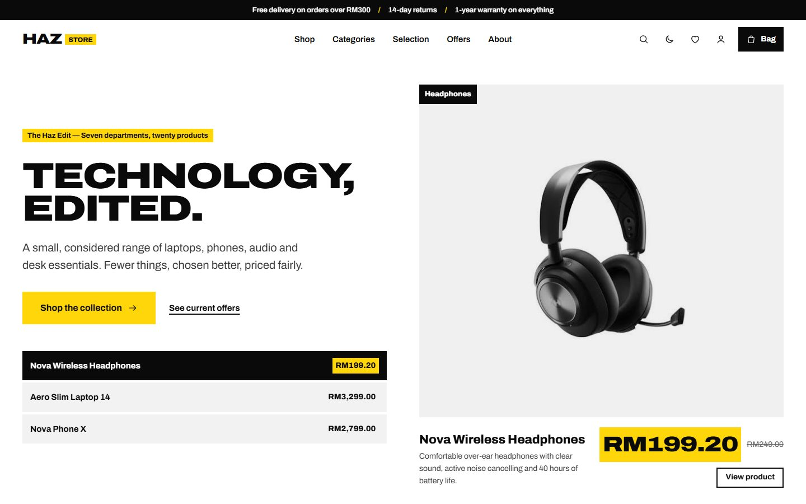 | 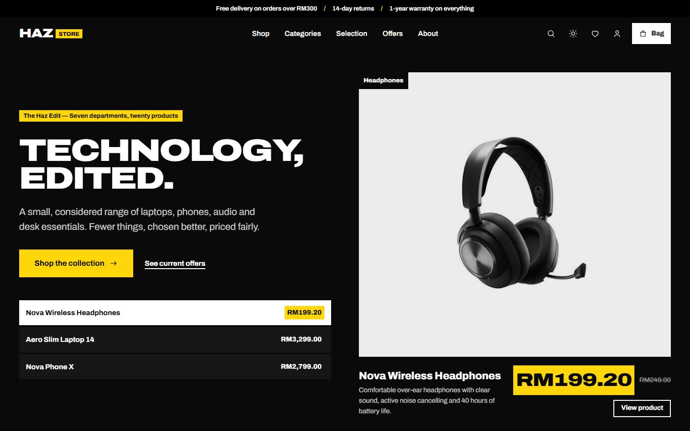 |
| Desktop product grid | 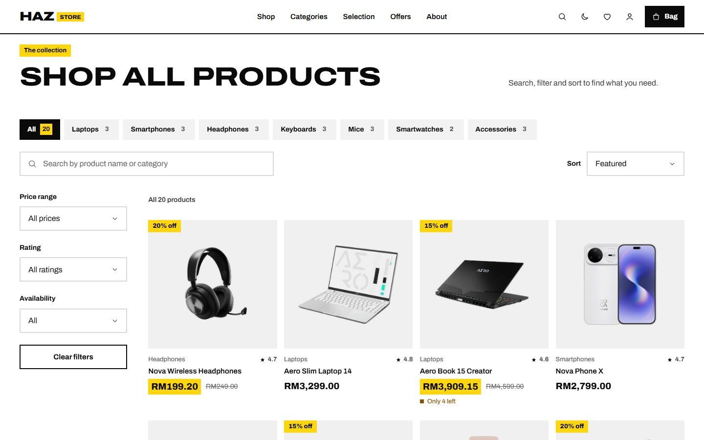 | 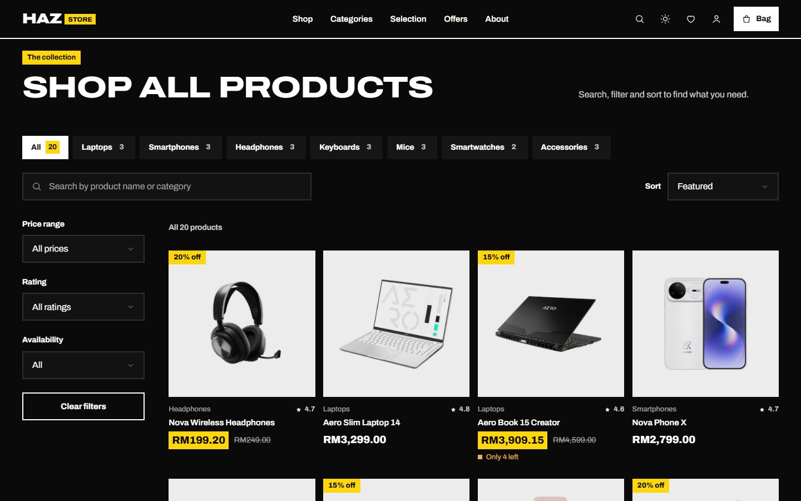 |
| Desktop product sheet | 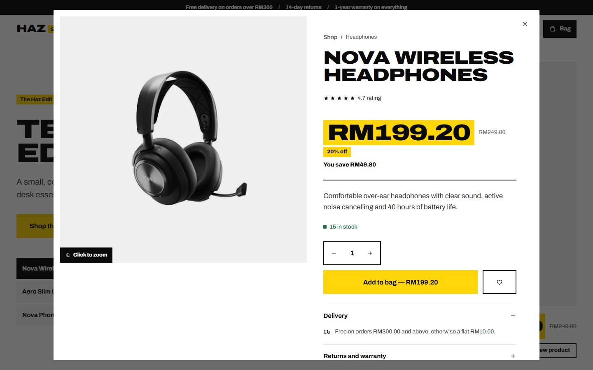 | 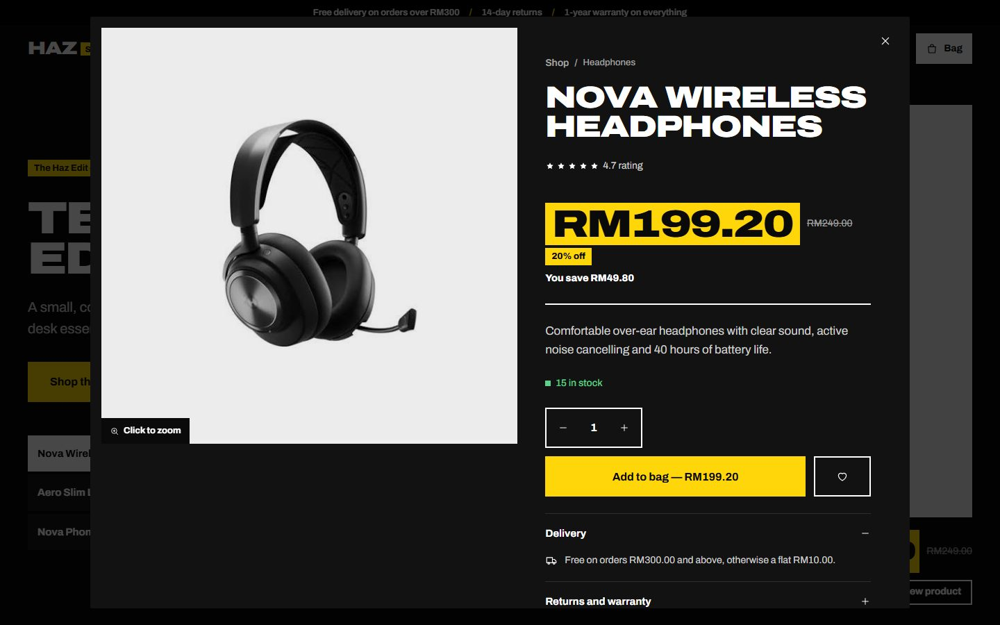 |
| Desktop bag | 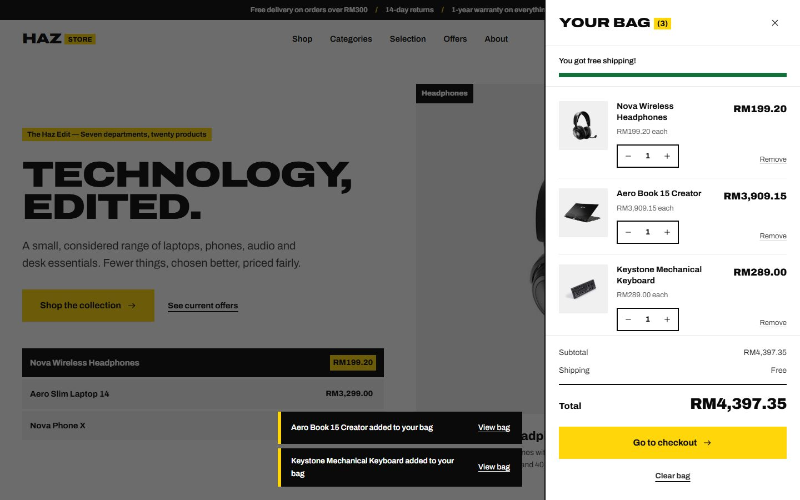 | 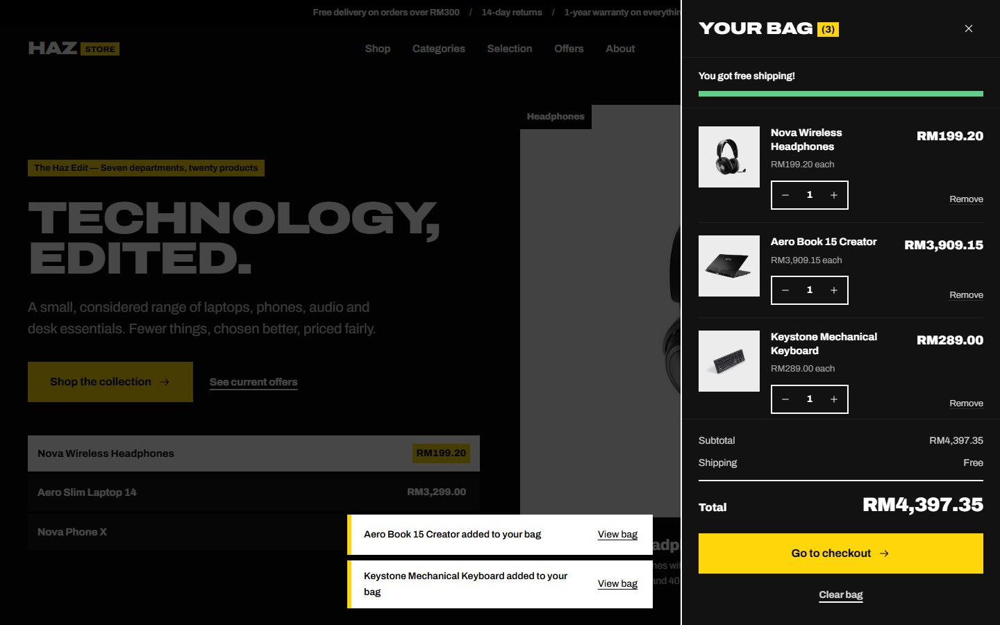 |
| Phone hero | 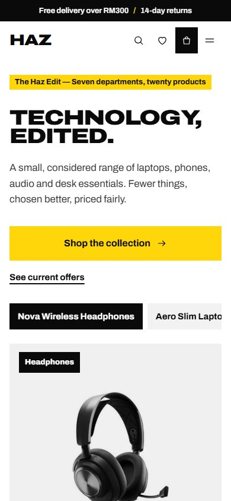 | 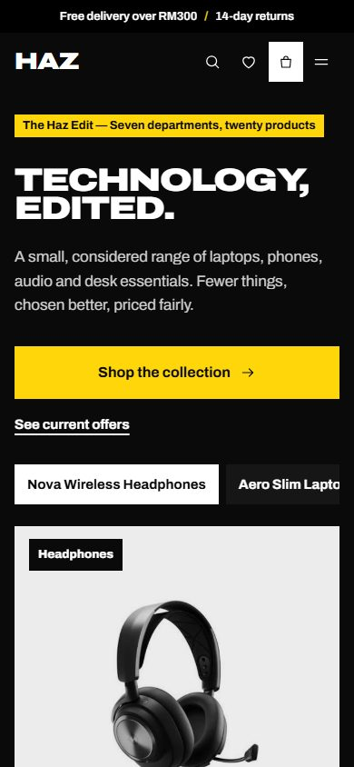 |
| Phone product grid | 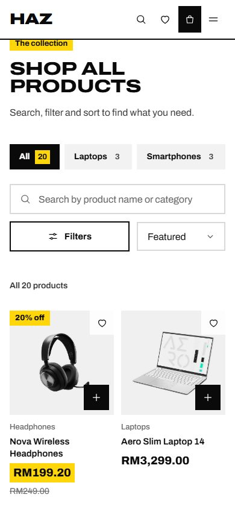 | 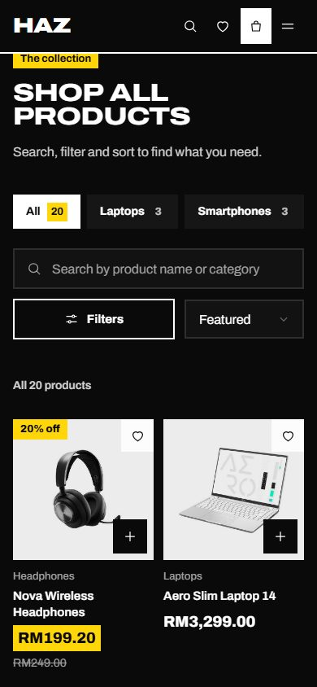 |
| Phone product sheet | 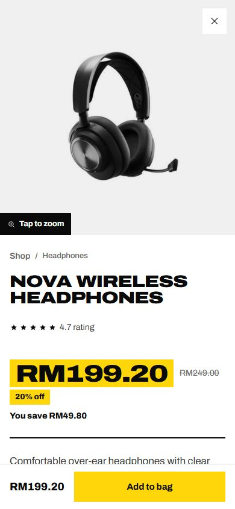 | 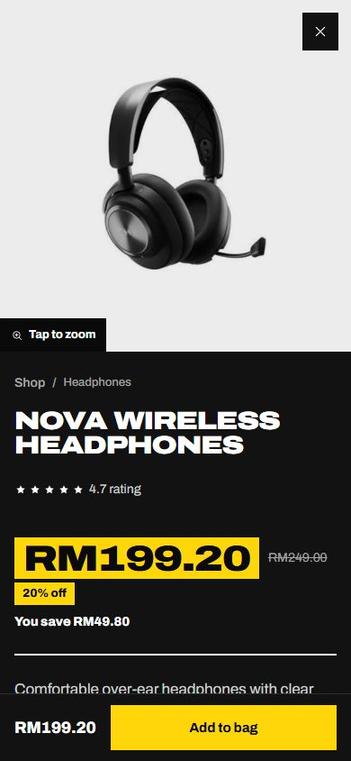 |
| Phone bag | 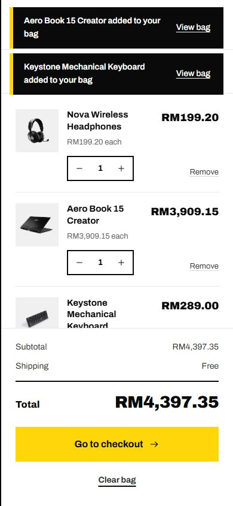 | 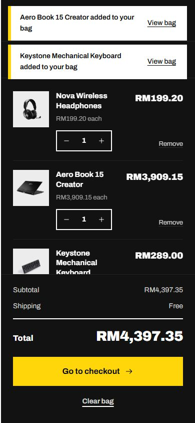 |

## Checks

- No horizontal overflow at 1440px or 390px in either theme (`scrollWidth` equals `clientWidth`). Also checked at 375px.
- No console errors or exceptions while loading the page, opening the product sheet, adding three items to the bag and opening the bag.
