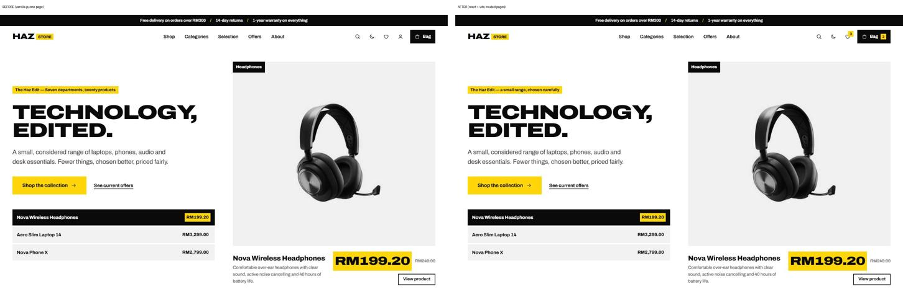
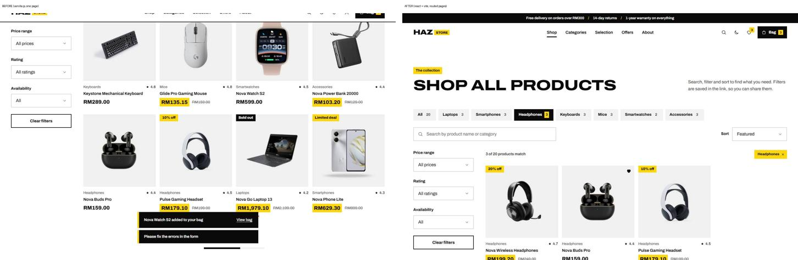
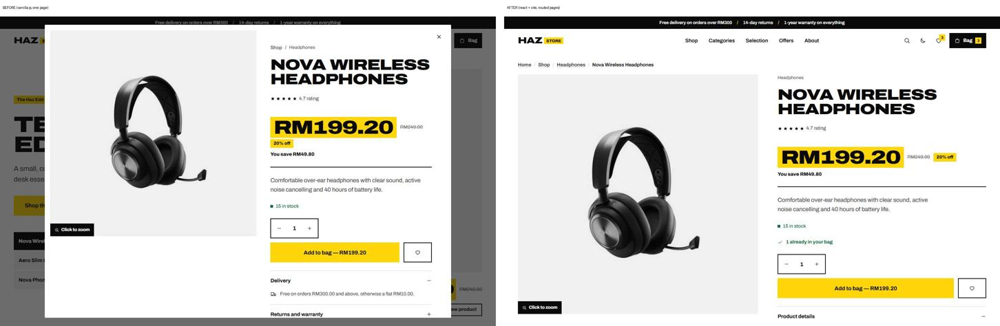

# HazStore 2.0: React + Vite upgrade

This note records what changed when the site moved from one vanilla JavaScript page to a React app, why, and how it was checked.

## Audit of version 1

- One `index.html` with every section, a 2,050 line `script.js` built on globals, string templates and `innerHTML`, and one 3,700 line stylesheet.
- No routes: product details were a modal, so a product could not be linked, bookmarked or opened in a new tab.
- Shop filters lived in memory and were lost on refresh or when sharing a link.
- Business rules (prices, totals, validation) were mixed with DOM code, so they could not be tested on their own; there were no automated tests.
- The data has no specs, release dates, sales numbers or extra photos. Anything that needs those (new arrivals, best sellers, spec tables, galleries) could only be faked, so it was not added.

## What stayed the same

- The visual identity: Archivo, black and white, signal yellow, hard edges, light and dark themes. The original CSS was split into files by area in the same cascade order, and the original class names are reused.
- All 20 products, 7 categories and product photos.
- Store rules: sale price rounding, "Limited deal" from 25% off, low stock from 5 left, RM10 shipping and free shipping from RM300, cart limited to stock, the price ranges, rating and availability filters, the five sorts, search on name and category, the checkout validation patterns, the order number format and the three payment options.
- The local storage keys (`HazStoreCart`, `HazStoreWishlist`, `HazStoreRecent`, `HazStoreTheme`), so items saved by version 1 still load.

## What changed

| Area | Version 1 | Version 2 |
| --- | --- | --- |
| Pages | one long page | `/`, `/shop`, `/product/:id`, `/cart`, `/wishlist`, `/checkout`, 404 |
| Product details | modal | own page with breadcrumb, details list, related and recently viewed |
| Filters | memory only | in the URL, restored by the back button |
| Search | shop field only | plus a header search with suggestions |
| Bag | drawer | drawer and a full bag page |
| Wishlist | drawer | own page |
| Checkout | instant success | validation, loading state, labelled demo confirmation |
| Data | global JS arrays | static JSON loaded once, with loading, error and retry states |
| Tests | none | 72 unit and DOM tests |

The "Account" button and footer links to pages that do not exist were removed or shown as plain text instead of opening "not built yet" messages.

## Technical decisions

- **React + Vite, plain JavaScript.** Moving to components and hooks was the main goal; TypeScript would have doubled the size of the change. Business rules live in `src/utils` as plain functions, which made them easy to test.
- **Context instead of a state library.** The shared state is small (catalog, bag, wishlist, recently viewed, toasts, open panel), so React context with `useLocalStorage` is enough. Product cards are memoized with stable callbacks, so changing the bag does not redraw every card.
- **No backend.** Products are a static JSON file, loaded through `catalogService` like an API would be. Entries with missing fields are skipped. There is nothing secret to store, so there are no environment variables.
- **URL as filter state.** `useProductFilters` reads and writes the query string and ignores unknown values. Typing in search replaces the history entry instead of adding one per key.
- **Accessibility built into shared hooks.** `useDialog` handles focus moving in, the tab trap, Escape and focus return for the bag drawer and the mobile filter sheet. After a route change focus moves to the new page heading. Drawers now become visible at the start of their slide-in animation so focus can land inside them right away.
- **Performance.** Only the home page is in the main bundle; other pages are split out and loaded when first visited. Images load lazily except the hero and product photos. The main script is 77 kB gzipped and the CSS 12 kB.
- **Honest content.** "Best sellers" became "Top rated", which comes from real rating data. No reviews, testimonials or sales numbers were added. The checkout never asks for card or bank details.

## Verification

Run in this environment on 16 November 2026:

- `npm test`: **72 passed** in 12 files (unit tests for utils and services, DOM tests that render the whole app with React Testing Library).
- `npm run build`: built without warnings.
- Browser QA in headless Chrome, on the dev server and again on the production build: **68 of 68 checks passed** with no console or network errors. Checks cover every route, filters and chips, back button, show more, header search, product quantity and stock limits, image zoom, drawer totals and shipping, the focus trap and focus return, wishlist, checkout errors, loading and confirmation, recently viewed, theme saving, no sideways scroll on phones, the mobile menu and filter sheet, and the mobile buy bar.
- axe-core (WCAG 2 A/AA plus best practices): **0 violations** on 8 routes in both light and dark themes. The first run found heading order problems on five pages; these were fixed before the final run.
- Screenshots at 1440, 1280, 820 and 390 px wide, light and dark.

More screenshots in this folder: `after-desktop-search.jpg`, `after-desktop-drawer.jpg`, `after-desktop-cart.jpg`, `after-desktop-checkout.jpg`, `after-desktop-wishlist.jpg`, `after-tablet-shop.jpg`, `after-mobile-*.jpg` and two dark mode views.

## Known limits

- The demo checkout keeps the confirmation in memory only; refreshing the page clears it.
- Each product has one photo, so the gallery offers zoom only, not thumbnails.
- There are no real accounts, orders, payments or deliveries.
- Lighthouse was not run for this version, and the tests run in jsdom, which does not do layout. Layout was checked in headless Chrome instead.
- Fonts load from Google Fonts, so the first visit needs an internet connection for the exact typeface (system fonts are used until then).
